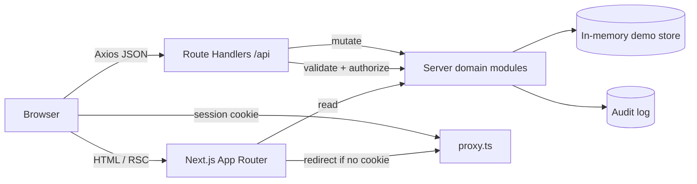
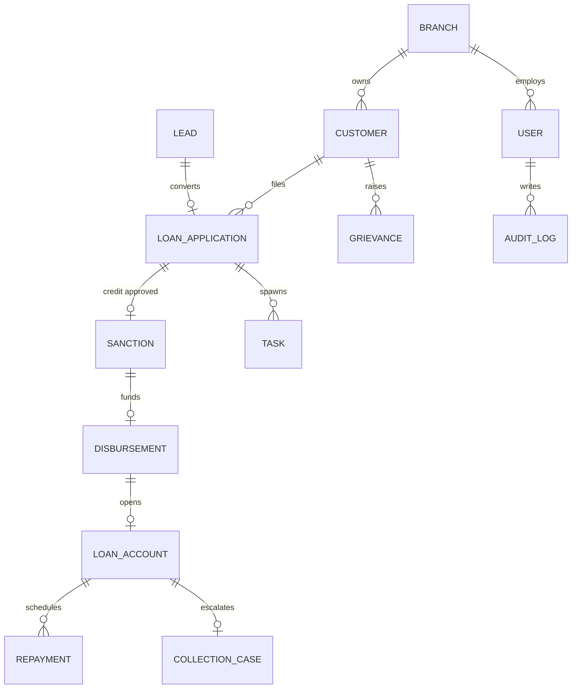

# Architecture

## 1. Context

FinCloud LMS is a single Next.js application that demonstrates a complete retail-lending back office. It is intentionally self-contained: the UI, API layer, authorization model and synthetic data store live in one deployable, with no external services. That makes the demo reproducible and keeps production systems untouched.

Design goals:

- **Lifecycle fidelity** — every module maps to a stage in the lending workflow and enforces that stage's guards.
- **Server-side authority** — permission and branch checks are never client-only.
- **Premium enterprise UX** — dense but legible data views, a collapsible shell, consistent states.
- **Safe demo** — synthetic data only, deterministic seed, explicit DEMO labelling at every integration boundary.

## 2. High-level shape

- **Server Components** render every list, detail and aggregate view. Reads are scoped in `src/server/*` before data reaches JSX.
- **Route Handlers** own mutations. They parse JSON, validate with Zod, enforce permission + branch scope, mutate the store, append an audit entry and return a typed result.
- **Client Components** are limited to interactivity: filters, tables, modals, boards and charts. They call typed services in `src/services/*`, then `router.refresh()` to re-render server data.
- **`src/proxy.ts`** performs an early cookie-presence redirect for workspace routes. It is a UX guard only; real authorization happens in the server modules.

## 3. Layers

| Layer | Location | Responsibility |
| --- | --- | --- |
| Route guard | `src/proxy.ts` | Redirect unauthenticated workspace requests to `/login?next=…` |
| Pages | `src/app/(app)/**/page.tsx`, `src/app/login` | Permission gate, data assembly, layout, tab routing via search params |
| Route Handlers | `src/app/api/**/route.ts` | HTTP boundary: zod validation, `requireSession`, `assertPermission`, `assertBranchScope`, `errorResponse` |
| Domain modules | `src/server/*.ts` | Business rules, state machines, scoping, aggregation, audit writes |
| Store | `src/server/store.ts`, `src/server/seed.ts` | Deterministic synthetic dataset in `globalThis`, id/ref sequencing, audit append |
| Validation | `src/lib/validation/*.ts` | Zod schemas shared by handlers and client forms |
| Client services | `src/services/*.ts` | Typed `getJson` / `postJson` / `patchJson` wrappers over the Axios singleton |
| Client state | `src/store/*`, `src/components/providers.tsx` | Redux (session, UI, notifications) and providers |
| UI kit | `src/components/ui/*` | Button, inputs, cards, badges, tables, tabs, modals, toasts, states, charts, upload |
| Shell | `src/components/layout/*` | Collapsible sidebar, header, global search, notifications, profile menu |

## 4. Request lifecycle

### Read (list / detail / dashboard)

1. `proxy.ts` sees a session cookie and allows the request.
2. The page calls `getSessionUser()` (verifies the HMAC token, resolves the active user).
3. The page checks `can(user, "<module>:view")`; otherwise it renders `<PermissionDenied />`.
4. A server module builds a `Scope` (`buildScope`) and filters records by branch before aggregation.
5. The page renders Server Components; client tables receive already-scoped rows.
6. A missing or out-of-scope record throws `ApiError(404)` / `ApiError(403)`; pages map these to `notFound()` / `<PermissionDenied />`.

### Mutation

1. A client component submits through a typed service (e.g. `leadActionRequest`).
2. Axios posts to `/api/...` with the HttpOnly cookie.
3. The handler validates the payload with Zod (422 with field errors on failure).
4. `requireSession()` → `assertPermission()` → module-level `assertBranchScope()`.
5. The domain module enforces the state machine (409 on invalid transitions) and business rules (422).
6. The mutation is applied, an activity and audit entry are appended, and a typed result is returned.
7. The client shows a toast, calls `router.refresh()`, and Server Components re-render with fresh data.

The Axios interceptor centralizes error mapping (`ApiClientError`) and redirects to `/login?expired=1` on `401` for non-login pages.

## 5. Domain model

Core entities (see `src/lib/types.ts`):

- **Reference data** — `Branch`, `User`, `Customer`.
- **Origination** — `Lead` (+`FollowUp`), `LoanApplication` (+`DocumentCheck`, `verification`, `CreditDecision`, `Activity`).
- **Fulfilment** — `Sanction`, `Disbursement`, `LoanAccount`, `Repayment`.
- **Servicing** — `CollectionCase`, `Task`, `AuthorizationRequest`.
- **Support & governance** — `Grievance`, `BlacklistEntry`, `ESignRequest`, `Notification`, `AuditLog`.

All monetary values are integer rupees. Dates are ISO strings. References follow `PREFIX-YYYY-NNNN` (e.g. `APP-2026-0008`) and are sequenced per entity.

## 6. Demo store

`src/server/store.ts` lazily initialises a `Store` on `globalThis`:

- **Deterministic seed** — seeded PRNG (mulberry32, seed `20261115`) builds 5 branches, a 30+ user organisation, **58 customers**, **160 leads**, **95 applications**, and linked sanctions, disbursements, loan accounts, repayment schedules, collection cases, tasks, authorizations, notifications, grievances and audit entries.
- **Synthetic identifiers** — masked PAN/Aadhaar, `@example.com` mailboxes, non-routable phone numbers.
- **Reset semantics** — restarting the Node process rebuilds the seed. Mutations are not persisted to disk.
- **Audit** — `appendAudit` writes actor, action, entity, summary and timestamp; the log is capped in memory.
- **Isolation** — the store is in-process and contains no production connection string or credentials.

The seed is demo tooling, not a migration. There is no database schema to alter.

## 7. UI shell

- **Sidebar** — permission-filtered nav sections, badge counts from `src/server/shell.ts`, collapsible state in Redux, mobile drawer.
- **Header** — breadcrumb-derived title, global search (`⌘K` / `Ctrl+K`), notifications popover, profile menu, sign-out.
- **Page pattern** — `PageHeader` (eyebrow, title, description, breadcrumbs, actions) → stat strip → tabs (URL-driven) → filters → data table / cards → detail drawers or modals.
- **Design system** — Tailwind 4 `@theme` tokens (`brand`, `ink`), `surface` cards, status tones, tabular numerals for money and references.
- **States** — skeleton loading, empty, error, permission-denied and inline DEMO warnings are provided by shared components.

## 8. Security posture

- HttpOnly, SameSite=Lax session cookie; `Secure` in production; 8-hour TTL; no tokens in `localStorage` or `sessionStorage`.
- HMAC-SHA256 signed token; constant-time signature comparison; scrypt password hashes with per-deployment salt in the demo seed.
- Server-side RBAC and branch scoping on every read and mutation; `401`/`403` handled centrally on the client.
- Zod validation at every API boundary; safe JSON error envelopes; no stack traces returned.
- Security headers (`nosniff`, `DENY` framing, referrer policy, permissions policy) in `next.config.ts`.
- Audit trail for mutations and exports.
- Input uploads are simulated; no untrusted file bytes are written to disk.

See [auth-and-rbac.md](auth-and-rbac.md) for the full model.

## 9. Branding

- Official logo: `public/assets/brand/fincloud-logo.png`, served locally and never hotlinked.
- Favicon: `src/app/icon.png`.
- The logo is used in the shell, login, loading and printable/report contexts without distortion or recolouring.
- Palette: navy structure, white surfaces, grey neutrals, green brand accents.

## 10. Scale notes

The demo is sized for interactive exploration, not load testing. List queries are linear scans over in-memory arrays; pagination for very large collections (e.g. audit logs) is performed client-side over the scoped result set. A production build would replace the store with a transactional database, add server-side pagination and move exports/async jobs to workers. Those changes are deliberately out of scope and flagged in the integration checklist.
