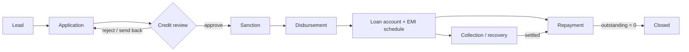
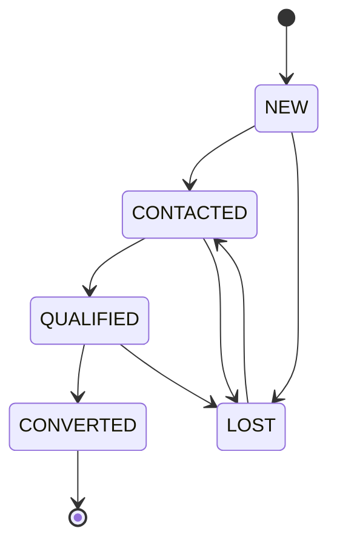
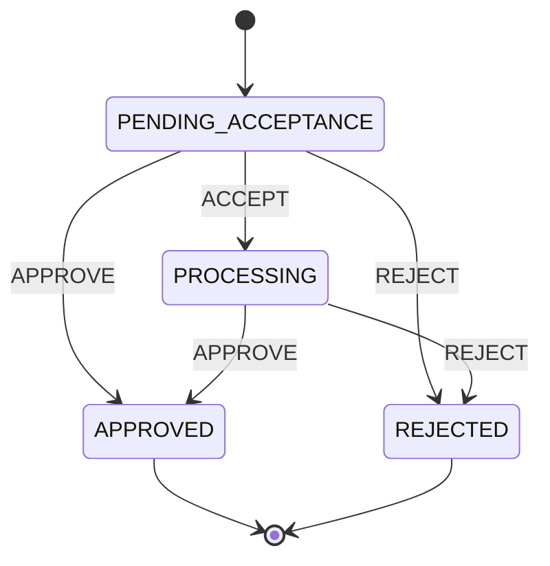
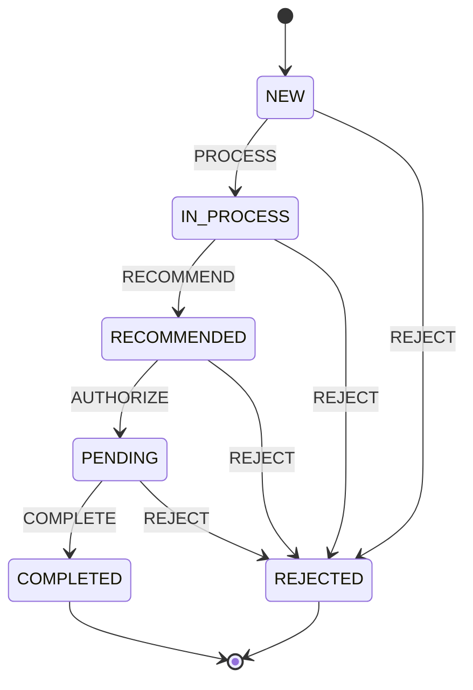
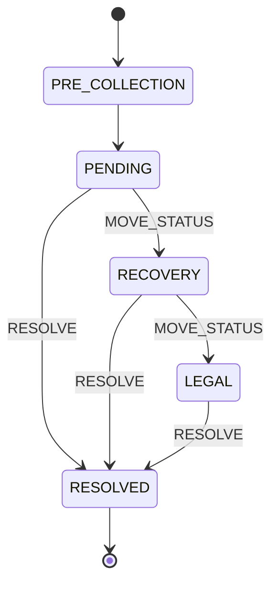

# Business Workflows

This document describes the state machines, entry gates, side effects and permissions implemented by the
demo domain layer in `src/server`. Every transition below is enforced server-side; the UI only offers the
actions the API will accept.

Related reading: [Architecture](architecture.md) · [Modules, routes & API](modules-and-routes.md) ·
[Auth & RBAC](auth-and-rbac.md).

---

## 1. Lifecycle overview



Every stage is branch-scoped. A user can only read or act on records whose `branchId` falls inside their
scope (`buildScope` / `inScope` / `assertBranchScope`). Global roles (`SUPER_ADMIN`, `ADMIN`) see all
branches; every other role is confined to its own branch.

---

## 2. Lead

**Statuses:** `NEW → CONTACTED → QUALIFIED → CONVERTED`; `LOST` is reachable from `NEW`, `CONTACTED`,
`QUALIFIED`; `LOST → CONTACTED` restarts nurturing. `CONVERTED` is terminal.



| Operation | Permission | Gate | Side effects |
| --- | --- | --- | --- |
| Update details | `leads:manage` | Lead in scope; owner must be an active user in the same branch (on assign) | Activity + audit entry |
| Assign owner | `leads:assign` | Owner active, in scope, same branch (`OWNER_BRANCH_MISMATCH` otherwise) | Reassignment activity + audit |
| Change status | `leads:manage` | Must match `LEAD_TRANSITIONS` (`INVALID_TRANSITION` otherwise) | Status activity + audit; `LOST` clears the next follow-up |
| Log follow-up | `leads:manage` | Converted leads are locked (`LEAD_CONVERTED`) | Follow-up entry; an implicit `NEW → CONTACTED` promotion; optional next follow-up date |
| Convert to application | `leads:manage` **and** `applications:manage` | Lead must be `QUALIFIED` and not already converted | Creates a synthetic customer, an application (`NEW`) with a pending document checklist, marks the lead `CONVERTED`, links `convertedApplicationId`, writes activities and both audits |

Follow-up logging is the only path that promotes a lead without an explicit status action. `CONVERTED`
leads reject new follow-ups to keep the audit trail clean.

---

## 3. Application & document checklist

**Statuses:**

```
NEW ──submit──▶ IN_PROCESS ──recommend──▶ RECOMMENDED ──credit──▶ CREDIT_APPROVED ──sanction──▶ SANCTIONED
                   ▲   │                        │                        │
                   │   └──documents/verification │                        ├──▶ CREDIT_REJECTED  (terminal)
                   │                            │                        │
                   │        SENT_BACK ◀─send-back┘                        └──▶ DISBURSEMENT_PENDING
                   │            │
                   └──resubmit──┘
                                                                          └──disburse──▶ DISBURSED ──▶ CLOSED
```

`CREDIT_REJECTED` is terminal. `CLOSED` exists on seeded historical files; the live closure path closes
the loan account and leaves the application at `DISBURSED` (see §9 gaps).

### 3.1 Submission gate

| Step | Action | Permission | Gate |
| --- | --- | --- | --- |
| 1 | Upload documents | `applications:manage` | Document `PENDING → UPLOADED`; only while the application is `NEW`, `IN_PROCESS` or `SENT_BACK` (documents lock after a credit outcome) |
| 2 | Verify documents | `applications:manage` | Document `UPLOADED → VERIFIED` or `UPLOADED → REJECTED`; a rejected document cannot be re-uploaded or re-verified, so it blocks recommendation |
| 3 | Complete verification | `applications:manage` | Identity, address, employment and income each set to `PENDING / VERIFIED / FAILED`; locked once the file leaves `IN_PROCESS` |
| 4 | Submit | `applications:manage` | Only from `NEW`; every **required** document must be uploaded (not necessarily verified) |
| 5 | Recommend to credit | `applications:manage` | Only from `IN_PROCESS`; every required document must be **verified** and all four verification fields `VERIFIED`; a credit officer (or branch manager) in scope must be assignable |
| 6 | Resubmit | `applications:manage` | Only from `SENT_BACK`; clears the send-back reason and returns the file to `IN_PROCESS` |

`new` and `auto` queues on the applications list are derived filters, not statuses. `isAuto` marks files
created by the demo's auto-origination seed path.

### 3.2 Mutation endpoints

`PATCH /api/applications/[id]` accepts `UPDATE`, `SUBMIT`, `DOCUMENT`, `VERIFICATION`, `RECOMMEND` and
`RESUBMIT`. The handler validates the payload with Zod, then delegates to the domain functions, which
re-check the application status, branch scope and permission. Document and verification updates are
audited individually so the file history stays complete.

---

## 4. Credit review

**Trigger:** application status `RECOMMENDED` only.

| Decision | Required input | Resulting application status | Sale of record |
| --- | --- | --- | --- |
| `APPROVE` | Approved amount `> 0` and `≤ requestedAmount`, risk band, remark ≥ 5 chars | `CREDIT_APPROVED` | Decision stored with amount, risk band and remarks |
| `REJECT` | Remark ≥ 5 chars | `CREDIT_REJECTED` | Terminal; reason kept on the file |
| `SEND_BACK` | Reason ≥ 5 chars | `SENT_BACK` | Reason exposed to the owner; resubmission allowed |

Permission: `credit:decide`. The decision maker becomes the application's `creditOfficerId`. Every
decision writes an application activity and an audit entry. A sanction is **not** created automatically;
see §5 and the gaps list.

---

## 5. Sanction

**Statuses:** `PENDING_ACCEPTANCE → PROCESSING → APPROVED`; `REJECTED` from either open status.



| Action | Permission | Gate | Side effects |
| --- | --- | --- | --- |
| `ACCEPT` | `sanctions:decide` | Status must be `PENDING_ACCEPTANCE` | Status `PROCESSING`; acceptance remark; activity + audit. DEMO: no e-signature is captured |
| `APPROVE` | `sanctions:decide` | Status `PENDING_ACCEPTANCE` or `PROCESSING` | Status `APPROVED`; approver + decision time; linked application (`CREDIT_APPROVED` or `SANCTIONED`) moves to `SANCTIONED` |
| `REJECT` | `sanctions:decide` | Not already `APPROVED` / `REJECTED`; remark ≥ 4 chars | Status `REJECTED`; reason retained; activity + audit |

The detail view derives the EMI from the approved amount, rate and tenure, plus total payable. It links to
a disbursement if one already exists for the sanction.

> Sanctions are seeded in the demo. There is no UI/API to raise a **new** sanction from a
> `CREDIT_APPROVED` application yet — that intake is listed under backend integration below.

---

## 6. Disbursement

**Statuses:** `NEW → IN_PROCESS → RECOMMENDED → PENDING → COMPLETED`; `REJECTED` from any non-completed
status. Maker actions (`PROCESS`, `RECOMMEND`, `AUTHORIZE`) need `disbursements:process`; checker actions
(`COMPLETE`, `REJECT`) need `disbursements:approve`. The checker permission is intentionally separate so a
branch manager can approve without processing, and a loan officer can process without approving.



| Action | Application effect | Notes |
| --- | --- | --- |
| `PROCESS` | — | Processing starts; no bank file is generated (DEMO) |
| `RECOMMEND` | — | Queued for the checker |
| `AUTHORIZE` | `SANCTIONED → DISBURSEMENT_PENDING` | Sent to the authorization queue; still no money moves |
| `COMPLETE` | Any linked application → `DISBURSED` | Creates a loan account and EMI schedule; generates a `DEMO…` bank reference; remarks state that no real transfer occurred |
| `REJECT` | `DISBURSEMENT_PENDING → SANCTIONED` | Remark ≥ 4 chars required; payout can be retried |

### 6.1 Loan creation on `COMPLETE`

`applyDisbursementAction` performs one atomic in-memory transaction:

1. Rejects duplicate completion (`ALREADY_COMPLETED`) and existing loan accounts for the disbursement.
2. Reads rate/tenure from the sanction (falling back to the application).
3. Computes the EMI with the reducing-balance amortisation formula.
4. Creates a loan account (`ACTIVE`, principal = disbursement amount, outstanding = principal, DPD 0).
5. Generates an instalment schedule with principal and interest split. **Demo schedule length is clamped
   to 6–12 instalments** regardless of the sanctioned tenure, so lifetime schedules are illustrative.
6. Marks the disbursement `COMPLETED`, stamps the bank reference and moves the application to `DISBURSED`.
7. Writes disbursement/application activities, a notification and an audit entry.

No real bank integration, payout file or settlement confirmation exists.

---

## 7. Repayment, overdue and closure

**Instalment statuses:** `PENDING → OVERDUE → PAID`; penalties accrue on overdue instalments in the seed.
**Loan statuses:** `ACTIVE`, `OVERDUE`, `CLOSED`, `WRITTEN_OFF` (write-off is seeded only).

The only repayment mutation in the demo is the collections panel:

`POST /api/repayments/[id]` with `{ mode: "NACH" | "UPI" | "NEFT" | "CASH" }`, permission
`collections:manage`, branch-scoped.

Gates and effects:

- The instalment must currently be `OVERDUE` (`INVALID_STATE` otherwise) and must be the **oldest**
  overdue instalment on the loan (`OUT_OF_ORDER` otherwise). This prevents cherry-picking.
- Marks the instalment `PAID` with a synthetic receipt number and selected mode.
- Reduces `loan.outstanding` by the instalment's principal component and adds the paid amount.
- Recomputes the loan:
  - `outstanding ≤ 0` → `CLOSED`, DPD 0;
  - no overdue instalments remain → `ACTIVE`, DPD 0;
  - otherwise → `OVERDUE`, DPD from the oldest overdue instalment.
- Advances `nextDueDate` to the next pending or overdue instalment.
- Updates the open collection case's overdue amount and DPD; if no overdue instalments remain, the case is
  automatically `RESOLVED` with a `CASE_RESOLVED` activity.
- Writes `PAYMENT_RECORDED` to the audit log.

`CUSTOMER 360` reads this schedule without duplicating logic; the repayment tab is view-only.

---

## 8. Collections & recovery

**Case statuses:** `PRE_COLLECTION`, `PENDING`, `RECOVERY`, `LEGAL`, `RESOLVED`.
**Buckets:** `PRE_DUE`, `BUCKET_1` (1–30 DPD), `BUCKET_2` (31–60), `BUCKET_3` (61–90), `NPA` (90+).
`PRE_COLLECTION` cases are pre-due reminders; all others are overdue accounts.



| Action | Permission | Gate | Side effects |
| --- | --- | --- | --- |
| `LOG_CONTACT` | `collections:manage` | Note ≥ 3 chars; next action cannot be in the past (defaults to +2 days) | Updates last contact and next action; activity |
| `SET_PTP` | `collections:manage` | Amount > 0; promise date not in the past | Stores PTP amount/date, sets next action and recovery stage; activity |
| `MOVE_STATUS` | `collections:manage` | Only `PENDING → RECOVERY` and `RECOVERY → LEGAL` (`allowedCollectionTransitions`) | Updates stage; activity |
| `RESOLVE` | `collections:manage` | Note ≥ 5 chars | Clears PTP, sets `RESOLVED`, activity |

Resolved cases reject every further action (`CASE_RESOLVED`). A repayment that clears all overdue
instalments resolves the case automatically. Recovery and legal movement are bookkeeping only; no agency,
legal or field-system integration exists.

---

## 9. Tasks

**Statuses:** `OPEN`, `IN_PROGRESS`, `ESCALATED`, `COMPLETED`, `CANCELLED`.
**Categories (7):** Credit, Collection, Field, Legal, Agency, GRE, Other.
**Related entities:** Lead, Application, Loan, Collection, Grievance, or none.

`allowedTaskTransitions` is the single source of truth for the board:

| Current | Allowed next |
| --- | --- |
| `OPEN` | `IN_PROGRESS`, `COMPLETED`, `CANCELLED`; plus `ESCALATED` when past due |
| `IN_PROGRESS` | `OPEN`, `COMPLETED`, `CANCELLED`; plus `ESCALATED` when past due |
| `ESCALATED` | `IN_PROGRESS`, `COMPLETED`, `CANCELLED` |
| `COMPLETED` | `OPEN` (reopen) |
| `CANCELLED` | — (terminal) |

Creation requires `tasks:manage`; the assignee must be active and inside the creator's scope. Moving a task
to `COMPLETED` stamps `completedAt`; reopening clears it. Every change is audited. Overdue escalation is a
user action, not an automatic scheduler, because the demo has no background workers.

---

## 10. Authorizations

**Statuses:** `PENDING → APPROVED | REJECTED` (both terminal).

| Action | Permission | Gate |
| --- | --- | --- |
| Raise request | `authorizations:view` | Title ≥ 5 chars, entity ≥ 3 chars; `PAYMENT` requests need amount > 0 |
| Approve / reject | `authorizations:approve` | Status `PENDING`; rejection remark ≥ 5 chars |

A creator can see their branch's queue but cannot decide without `authorizations:approve`. The queue is a
workflow record only — it does not trigger a payout, LMS account action or agency instruction. The
disbursement authorization flow is modelled separately inside the disbursement state machine (§6).

---

## 11. Supporting operations

- **Blacklist** — active entries are added with masked identifiers only. Duplicate active names are
  rejected (`DUPLICATE_ENTRY`). Requires `operations:manage`; entries are branch-scoped.
- **Grievances** — statuses `OPEN → IN_REVIEW → RESOLVED` (any forward move allowed through the form).
  Requires `operations:manage`; resolving stamps `resolvedAt`, reopening clears it. Each update writes an
  audit entry with the status change and note.
- **eSign** — `NOT_INITIATED → INITIATED → SIGNED | FAILED`, seeded only. `provider` is always `DEMO_ESIGN`;
  no signing provider is called. The customer verification tab surfaces eSign state per application.
- **Audit log** — every mutation in this document appends an entry (`src/server/audit.ts`, capped at 500
  entries). The audit view requires `audit:view`.

---

## 12. Cross-cutting gates

1. **Session** — every route handler and workspace page calls `requireSession()`; the proxy redirects
   anonymous navigation to `/login?next=…`.
2. **Permission** — route handlers and server pages call `assertPermission` before any read or mutation.
   Domain functions repeat the check for defence in depth.
3. **Branch scope** — `assertBranchScope` runs after the record is loaded. Out-of-scope records return
   `403 OUT_OF_SCOPE`; missing records return `404`.
4. **Validation** — Zod schemas in `src/lib/validation` check shape and basic bounds before the domain
   layer applies business rules. A collection of field errors returns `422 VALIDATION`.
5. **Demo guardrails** — no money moves, no real documents, no external messaging, no bureau, no eSign
   provider. Every simulated action is labelled DEMO in the UI and in stored remarks.

---

## 13. Known workflow gaps (awaiting backend integration)

| Gap | Impact | Where marked |
| --- | --- | --- |
| No sanction intake from `CREDIT_APPROVED` applications | New files stop after credit approval; seeded sanctions continue the demo | Sanctions page, checklist |
| No disbursement intake from approved sanctions | New sanctions cannot generate payouts; seeded disbursements continue | Disbursements page |
| Repayment settlement only for the oldest overdue instalment | No prepayment, part-payment or early closure | Collections detail |
| Demo EMI schedule capped at 6–12 instalments | Lifetime schedule is illustrative, not the full tenure | Disbursement completion |
| Loan closure does not move the application to `CLOSED` | Application remains `DISBURSED`; closure is reflected on the loan | Customer 360 |
| No background scheduler | DPD, bucket movement, penalties and task escalation do not advance on a timer | Seeded data only |
| No free-text customer notes | Remarks are derived from lifecycle records | Customer 360 |
